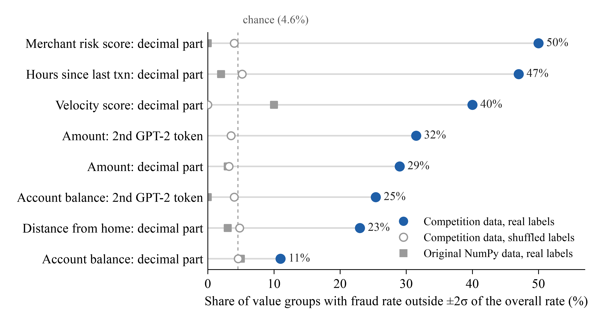
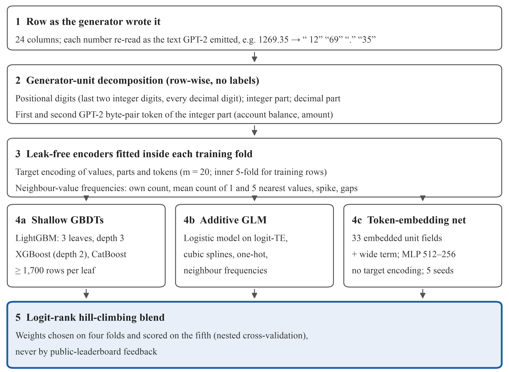
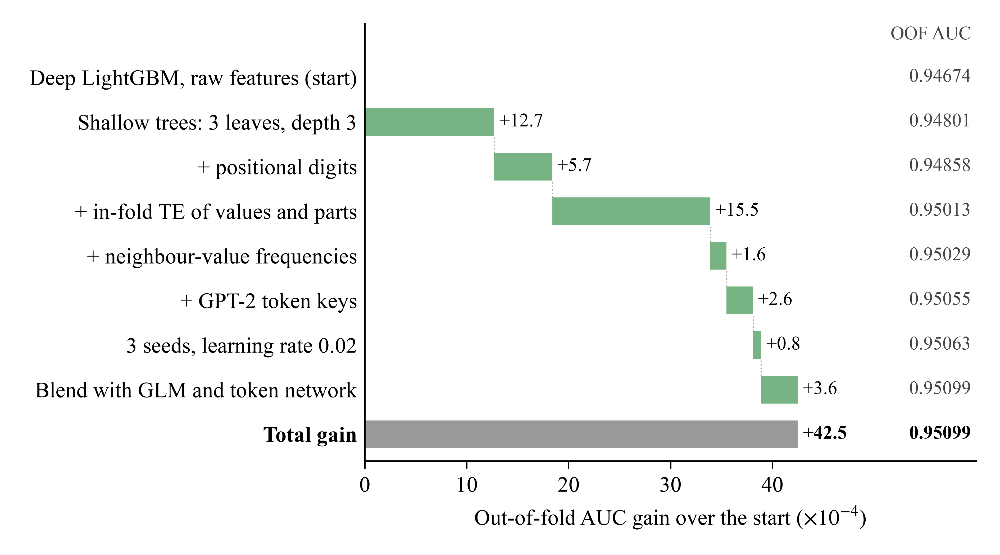

<div align="center">

# Reading the Generator's Handwriting

**Tokenizer-aware features for fraud detection on LLM-synthesised tabular data**

[](https://www.python.org/)
[](LICENSE)
[](https://www.kaggle.com/competitions/playground-series-s6e11)
[](manuscript/Generator_Handwriting_ESWA_manuscript.pdf)


</div>

When a language model writes your training data, **its tokens carry the label**. This repository contains the code, results and manuscript for a study of Kaggle's *Playground Series S6E11 – Predicting Credit Card Fraud* (699,960 synthetic transactions, 1.67% fraud, ROC-AUC). The rows were generated by a fine-tuned GPT-2 ([GReaT](https://arxiv.org/abs/2210.06280)-style), and the fraud label leaks through the units GPT-2 emitted: decimal endings and byte-pair tokens. Modelling those units beats tuning the learner.

## Key findings

| | Finding | Evidence |
|---|---|---|
| 🔍 | **The artefact comes from the generator, not from fraud.** 11–50% of decimal endings and GPT-2 tokens have fraud rates outside ±2σ, against 0–5% with shuffled labels or in the NumPy-simulated source data. | [`src/forensics.py`](src/forensics.py), Fig. 1 |
| 📈 | **Generator-aware features lift one LightGBM from 0.94674 to 0.95063 OOF AUC.** Every feature step improves all five folds. | [`src/exp3.py`](src/exp3.py), Fig. 3 |
| 🧩 | **A model that sees only decimal digits and token tails reaches 0.611 AUC**, with no magnitudes at all. | `artefact_only` in [`results/`](results/results_ablation.jsonl) |
| ➕ | **The signal is nearly additive.** Three-leaf trees beat 31-leaf trees by 0.0013, and a logistic GLM matches GBDTs within 0.0003. | [`src/glm.py`](src/glm.py) |
| 🎯 | **An honest blend reaches 0.95099** under nested cross-validation. Public scores tracked validation within 0.0006. | [`src/ensemble.py`](src/ensemble.py) |
| ⚠️ | **Public-leaderboard gaps below about 0.0005 are noise.** On 60,000-row slices the blend's +0.00040 edge flips sign 6% of the time. | Paper, Section 8.1 |

<p align="center">
  
  <br><sub><b>Fig. 1.</b> Funnel test per generator unit. Blue: competition data, real labels. Open circles: shuffled labels. Grey squares: original NumPy-simulated data. Dashed line: chance level.</sub>
</p>

## How it works

A GReaT-style generator serialises each row as text and samples it token by token, so to the generator `1269.35` is the sentence `" 12" "69" "." "35"`. The pipeline re-reads every number in those units, encodes them without label leakage and fits deliberately shallow models.

<p align="center">
  
</p>

1. **Generator-unit decomposition** (no labels). Positional digits, integer part, decimal part, and the first and second GPT-2 byte-pair tokens of the integer part.
2. **Leak-free encoders, fitted inside each training fold.** Smoothed target encoding (m = 20), using an inner 5-fold split for the training rows, plus neighbour-value frequencies (how "lonely" an exact value is).
3. **Three model families:**
    - shallow GBDTs: LightGBM with 3 leaves, XGBoost at depth 2, CatBoost at depth 3;
    - an additive logistic GLM;
    - a wide-and-deep token-embedding network trained on an Apple-silicon GPU.
4. **Logit-rank hill-climbing blend.** Weights are chosen on four folds and scored on the fifth, never by public-leaderboard feedback.

## Results

All numbers are out-of-fold ROC-AUC on one fixed stratified 5-fold split (seed 42), so differences are paired.

<p align="center">
  
</p>

| Model | Inductive bias | OOF AUC |
|---|---|---:|
| LightGBM, tokens + frequencies, 3 seeds | Shallow trees | 0.95063 |
| Logistic GLM | Additive, linear in logit TE | 0.95031 |
| CatBoost, depth 3 | Symmetric shallow trees | 0.94970 |
| Token-embedding network, 5 seeds | Learned embeddings, no TE | 0.94945 |
| XGBoost, depth 2 | Shallow trees | 0.94898 |
| **Logit-rank hill-climbing blend** | Ensemble | **0.95099** (nested) |

| Submission | Content | CV AUC | Public LB |
|---|---|---:|---:|
| v1 | Deep LightGBM + XGBoost, raw features | 0.94724 | 0.94754 |
| v2 | Shallow GBDTs + digits, TE, tokens, frequencies | 0.95069 | 0.95126 |
| v3 | v2 + GLM + token-embedding network | 0.95099 | pending |

<details>
<summary><b>What did not help</b> (negative results)</summary>

| Idea | OOF AUC | Δ |
|---|---:|---:|
| Original 20,000 rows appended to each fold | 0.94673 | −0.00001 |
| Per-value fraud rate measured on the original data | 0.94648 | −0.00026 |
| Logistic model fitted on the original data, as a feature | 0.94674 | 0.00000 |
| 30 hand-built domain features, deep LightGBM | 0.94568 | −0.00132 |
| Same domain features, XGBoost | 0.94523 | −0.00150 |

The original data carry no generator artefacts, and domain features only re-express magnitudes the trees already split on.
</details>

## Repository structure

```text
.
├── src/
│   ├── common.py         # data loading, fixed 5-fold split, OOF saving
│   ├── gpt2_tokens.py    # GPT-2 tokenizer download + integer token table
│   ├── forensics.py      # funnel test (paper Section 4)
│   ├── feats3.py         # generator-unit features, in-fold TE, neighbour frequencies
│   ├── exp3.py           # ablation ladder + artefact-only model
│   ├── exp_orig.py       # original-dataset experiments (negative results)
│   ├── train3.py         # shallow LightGBM / XGBoost / CatBoost (final pipeline)
│   ├── glm.py            # additive logistic model
│   ├── nn_tok.py         # token-embedding wide-and-deep network (PyTorch, MPS/CPU)
│   ├── ensemble.py       # logit-rank hill climbing with nested CV -> submission.csv
│   ├── train.py, train2.py, digits.py   # earlier baselines kept for the ablation history
├── results/              # small result tables used by the figures and the paper
├── manuscript/
│   ├── Generator_Handwriting_ESWA_manuscript.pdf   # paper (Elsevier ESWA format)
│   ├── build_docx.js     # builds the Word manuscript (docx-js)
│   ├── make_figures.py   # print figures from results/
│   └── fig/              # figures
├── data/README.md        # how to obtain the data (data are not redistributed)
├── Makefile              # one-command reproduction
├── requirements.txt
├── CITATION.cff
├── NOTICE.md             # third-party licences, data terms, compliance, AI disclosure
└── LICENSE               # MIT
```

## Quickstart

**Requirements:** Python 3.11 or newer (developed on 3.14), about 16 GB of RAM, and a Kaggle account that has joined the competition. Node.js 18 or newer is needed only to rebuild the manuscript.

```bash
git clone https://github.com/z5rcnws7bz-eng/reading-the-generators-handwriting.git
cd reading-the-generators-handwriting
python -m venv .venv && source .venv/bin/activate
pip install -r requirements.txt
```

Download the competition data as described in [`data/README.md`](data/README.md), then build the GPT-2 token table:

```bash
python src/gpt2_tokens.py
```

## Reproducing the paper

```bash
make forensics   # funnel test -> results/results_forensics.csv        (~1 min)
make ablation    # ablation ladder + artefact-only -> results/         (~10 min)
make models      # LightGBM, XGBoost, CatBoost, GLM, token network     (~1.5 h on an M5 laptop)
make blend       # nested-CV blend -> submission.csv                   (~1 min)
make figures     # manuscript/fig/*.png
make paper       # manuscript .docx (needs Node.js; PDF export via Word)
```

Every script also runs on its own, for example `python src/train3.py lgb --tok --nf --lr 0.02 --seeds 3 --tag _s3`. Runtimes are for one Apple M5 laptop with 10 CPU cores and 16 GB of RAM. The neural network uses the Apple GPU (MPS) when available and the CPU otherwise.

## Validation philosophy

- One stratified 5-fold split (seed 42) is shared by every model, so model comparisons are paired.
- Every supervised encoding is fitted inside the training fold, with an inner split for the training rows.
- The blend is scored by **nested** cross-validation.
- The public leaderboard is used as a sanity check only, never for selection. Section 8.1 of the paper shows why: a single public score varies by about ±0.003.

## Citation

If you use this work, please cite it. GitHub's **"Cite this repository"** button reads [`CITATION.cff`](CITATION.cff).

```bibtex
@misc{roman2026generatorhandwriting,
  title  = {Reading the Generator's Handwriting: Tokenizer-Aware Features for Fraud Detection on LLM-Synthesised Tabular Data},
  author = {Roman, Jace},
  year   = {2026},
  url    = {https://github.com/z5rcnws7bz-eng/reading-the-generators-handwriting}
}
```

## Licence, data terms and compliance

- **Code:** [MIT](LICENSE).
- **Data:** this repository does **not** redistribute any competition data, predictions or submissions. Kaggle competition data are subject to the [competition rules](https://www.kaggle.com/competitions/playground-series-s6e11/rules). Obtain them from Kaggle yourself.
- **Third-party components:** GPT-2 tokenizer files (Modified MIT), the CC0 source dataset, and ideas credited to public Kaggle notebooks are listed in [`NOTICE.md`](NOTICE.md).
- **Not a production fraud system.** The models are trained on synthetic data for a benchmark and have not been validated on real transactions. See [`NOTICE.md`](NOTICE.md) before using any part of this work for decisions about people.
- **AI disclosure:** the code, experiments and manuscript draft were produced with the help of Claude (Anthropic) and reviewed by the author. See [`NOTICE.md`](NOTICE.md).

## Acknowledgements

Thanks to Kaggle for the Playground Series and to uditjain13 for the CC0 source dataset. The GPT-2 token-key and neighbour-frequency ideas build on the public notebook by [azizdzhon](https://www.kaggle.com/code/azizdzhon/how-great-tokenizes-numbers-bpe-token-target).
